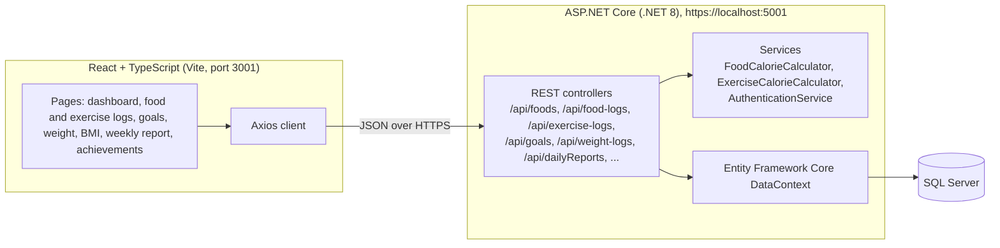

# ACTIV-ATE

A full-stack fitness tracker for logging meals and workouts, setting weight goals, and watching weekly progress, built with ASP.NET Core, Entity Framework Core, SQL Server and React.


Team project (four students) for **CMPS 285 Software Engineering, Southeastern Louisiana University, January to May 2025**. It was built on top of the course's `learning-starter` template, which is why the solution and project folders are still named `LearningStarter`.

## Overview

ACTIV-ATE lets a user create an account, enter their height, weight, birth date and gender, and then log what they eat and how they exercise each day. The back end turns those logs into numbers that are useful day to day: calories consumed against a personal daily calorie goal, calories burned per workout, and weight progress toward a target. The React front end shows this through a dashboard, logging forms, charts and an achievements page.

## Key features

- **Accounts and sign-in.** Sign-up and login backed by ASP.NET Core Identity with cookie authentication. A profile page shows the user's details, and the API includes a profile-picture upload endpoint.
- **Food logging.** A food catalog with nutrient data (calories, nutrient types and amounts per food), plus daily food logs grouped by meal time, with per-day calorie totals.
- **Exercise logging.** An exercise catalog and per-user exercise logs. Calories burned are calculated on the server from duration, the user's weight and a MET value.
- **Personalized calorie goal.** Setting a weight goal (target weight, time period and activity level) computes a daily calorie target using the Mifflin-St Jeor BMR formula, an activity multiplier, and the calorie adjustment needed to reach the target in time. The goal never drops below 1,200 kcal a day.
- **Weight tracking.** Log weigh-ins and see them on a line chart.
- **BMI calculator** with the standard category (underweight, normal, overweight, obese).
- **Weekly report.** Line charts of meal calories and exercise activity over a date range, built from the daily-report and exercise-log range endpoints.
- **Achievements.** The server checks the latest weigh-in against the active weight goal, and the page celebrates a reached goal with a confetti animation.
- **Meal planner.** Sample meal plans with ingredients and recipe steps (static content in the front end).
- **REST API with Swagger UI** for exploring and testing every endpoint.

## Architecture



- The ASP.NET Core app serves the REST API and, in development, proxies non-API requests to the Vite dev server on port 3001, so the whole app is used from one origin.
- Controllers return a shared `Response` envelope (data plus a list of field errors) that the front end reads consistently.
- Entity Framework Core maps the domain entities (`User`, `Food`, `FoodLog`, `Nutrient`, `NutrientType`, `Exercise`, `ExerciseLog`, `Goal`, `WeightLog`, `DailyReport`, `Achievement`, plus Identity roles) to SQL Server.
- On startup the app seeds roles, an admin user, and starter exercises, foods and nutrient data.

## Tech stack

| Layer | Technology |
| --- | --- |
| Backend | C#, ASP.NET Core (.NET 8) Web API controllers, ASP.NET Core Identity, cookie authentication, Swashbuckle (Swagger) |
| Data | Entity Framework Core 8, SQL Server |
| Frontend | React 18, TypeScript, Vite, Mantine 7 (core, forms, dates, charts, notifications), React Router 6, Axios, Recharts, Day.js |
| API style | REST/JSON |

## Project structure

```text
Web/
├── LearningStarter.sln
└── LearningStarter/                 # ASP.NET Core back end
    ├── Controllers/                 # REST endpoints (auth, users, foods, logs, goals, reports...)
    ├── Entities/                    # EF Core entities and DTOs
    ├── Data/DataContext.cs          # EF Core DbContext
    ├── Services/                    # calorie calculators, authentication service
    ├── Common/                      # shared Response/Error types
    ├── Startup.cs                   # DI, auth, Swagger, SPA proxy, seed data
    ├── appsettings.json             # connection string and app settings
    └── learning-starter-web/        # React + TypeScript front end (Vite)
        └── src/
            ├── pages/               # feature pages
            ├── components/          # navigation, date picker, calorie progress bar...
            ├── authentication/      # auth context / hooks
            └── config/              # Axios and env var setup
```

## Getting started

**Prerequisites:** [.NET 8 SDK](https://dotnet.microsoft.com/download), Node.js with npm, and a SQL Server instance (SQL Server Express, LocalDB, or SQL Server in Docker all work).

### 1. Configure the database

Set the `DefaultConnection` connection string in `Web/LearningStarter/appsettings.json` (under `ConnectionStrings`) to point at your SQL Server. The committed value uses Windows authentication against a local server. If your server needs a username and password, keep them out of git, for example with environment variables:

```bash
# Overrides ConnectionStrings:DefaultConnection
export ConnectionStrings__DefaultConnection="Server=localhost,1433;Database=ActivAte;User Id=<user>;Password=<password>;TrustServerCertificate=True"
```

> **Heads-up:** `Startup.Configure` calls `EnsureDeleted()` and then `EnsureCreated()`, so the database is **dropped and recreated with fresh seed data every time the server starts**. Point it at a database you don't mind losing.

### 2. Run the back end

```bash
cd Web/LearningStarter
dotnet run
```

The API runs on `https://localhost:5001` (HTTP on `5000`). Swagger UI is at `https://localhost:5001/swagger`.

### 3. Run the front end

```bash
cd Web/LearningStarter/learning-starter-web
npm install
npm start
```

Vite serves the client on port `3001`, and the back end proxies to it in development, so browse to `https://localhost:5001`.

### Front-end environment variables

Read from `learning-starter-web/.env`:

| Name | Purpose |
| --- | --- |
| `VITE_REACT_APP_API_BASE_URL` | Base URL of the API used by the Axios client |
| `VITE_REACT_APP_ENVIRONMENT` | `local`, `development` or `production` |
| `VITE_REACT_APP_BUILD_NUMBER` | Build label (defaults to `local`) |
| `VITE_PORT`, `VITE_WDS_SOCKET_PORT` | Dev-server port settings |

## Team

Four-person team. Names and handles come from the repository's commit history.

- **Riyaj Chaulagain** ([@riyajclgn123](https://github.com/riyajclgn123)): most commits across both the API controllers and the React front end
- **Adam Rodi**
- **Sagar Bastola**
- **Rylie McDonald**

The original `learning-starter` template is by Zachary Whiddon (MIT License, see [LICENSE](LICENSE)).

## Author

**Riyaj Chaulagain**, Computer Science student at Southeastern Louisiana University

- GitHub: [riyajclgn123](https://github.com/riyajclgn123)
- Portfolio: [riyajchaulagain.com.np](https://riyajchaulagain.com.np)
